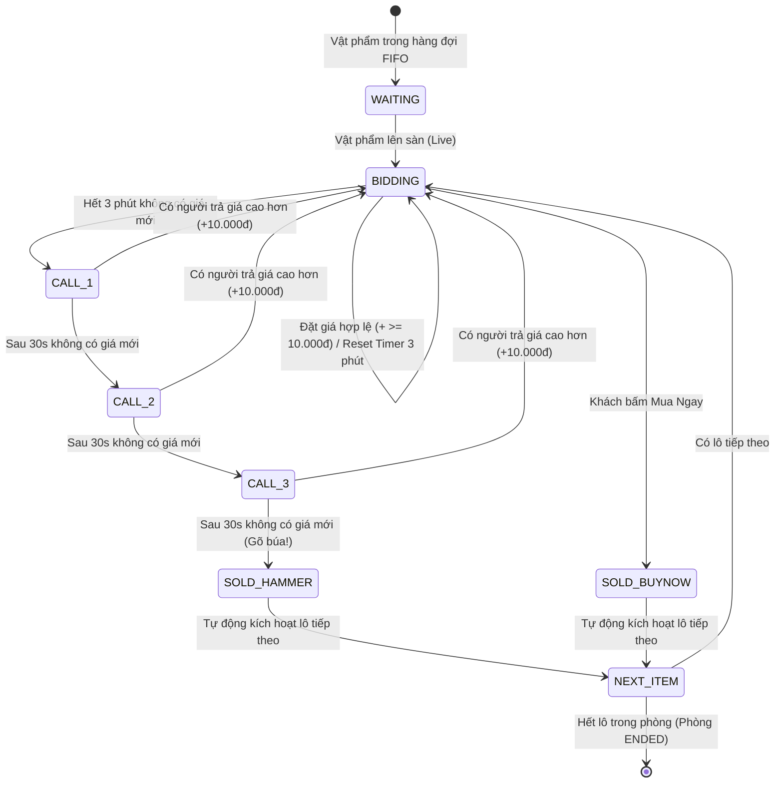

# System Architecture & Technical Blueprint

## 1. Kiến trúc tổng thể (Architecture Overview)

```
[ Client: React + Tailwind + Lucide ]
             │
             ├──────────── HTTPS / REST API ───────────┐
             │                                         ▼
             │                              [ Express.js API Server ]
             │                                         │
             ├────────── WSS / Socket.IO ──────────────┤
             │                                         ▼
             │                           [ Realtime Auction Engine ]
             │                             - FIFO Queue Manager
             │                             - Presence & Room Constraint
             │                             - 3-Call Countdown Timer
             │                                         │
             ▼                                         ▼
[ Docker Environment ] <────────────────────── [ Prisma ORM ]
                                                       │
                                                       ▼
                                            [ PostgreSQL Database ]
```

## 2. Mô hình dữ liệu Prisma (Entity Relationship)

- **User**: Định danh tài khoản, mật khẩu băm bcrypt, vai trò `ADMIN` hoặc `MEMBER`, số dư tài khoản.
- **Room**: Phòng đấu giá với mã phòng, tiêu đề, trạng thái (`UPCOMING`, `LIVE`, `ENDED`), ID người tạo, ID vật phẩm đang đấu (`currentItemId`).
- **Item**: Lô vật phẩm thuộc phòng, thông tin mô tả, ảnh, `startingPrice`, `buyNowPrice`, `currentPrice`, `minIncrement` (10.000đ), trạng thái (`WAITING`, `BIDDING`, `SOLD`, `UNSOLD`), thứ tự hàng đợi `queueOrder`, ID người bán, ID người thắng.
- **Bid**: Lịch sử đặt giá gồm `amount`, `itemId`, `bidderId`, thời điểm đặt giá.
- **RoomParticipant**: Trạng thái tham gia phòng của người dùng, liên kết `userId` với `roomId` và `socketId` để cưỡng chế nguyên tắc 1 phòng tại 1 thời điểm.
- **AuctionEventLog**: Ghi vết các sự kiện đấu giá: đặt giá mới, phát thông báo lần 1/2/3, gõ búa chốt giá, mua ngay.

## 3. Realtime Auction Engine Workflow


